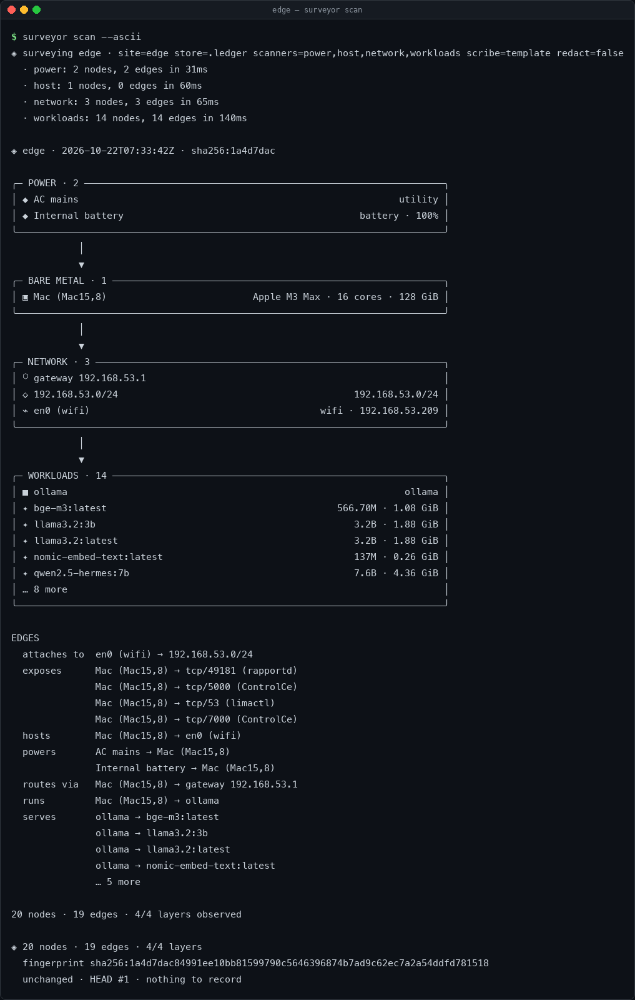
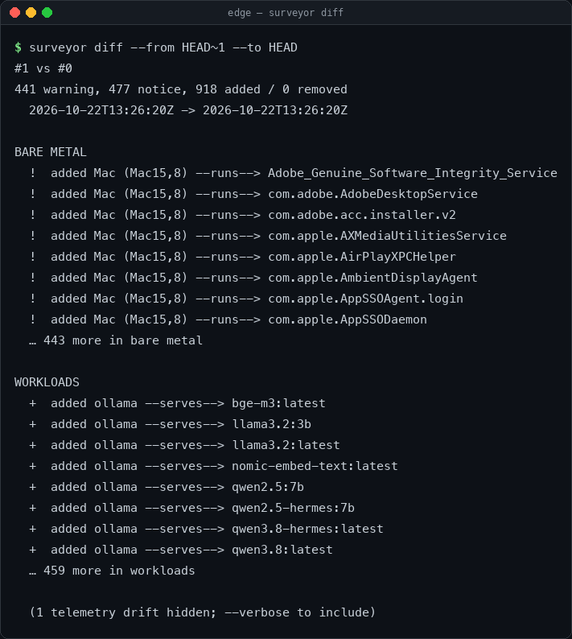
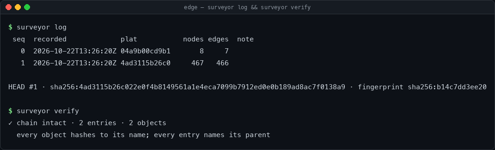
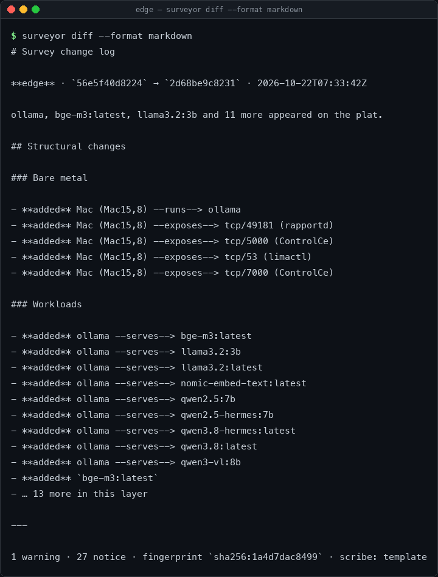

```text
          T H E   S U R V E Y O R                     O E T   1 . 0
          ───────────────────────────────────────────────────────────
                .-"""""-.
              .'   ___   '.                    ●───────●
             /    /   \    \                  /         \
            |    | === |    |  ─ ─ ─ ─ ─ ─▶  ●           ●
             \    \___/    /                  \         /
              '.    |    .'                    ●───────●
                '-..|..-'
                   |||                        plat no. 007
            ______|||______                  not to scale
           /   /       \   \
          /   /         \   \
         '___'           '___'
```

[](https://github.com/hamanakam1/the-surveyor/actions/workflows/ci.yml)
[](pyproject.toml)
[](pyproject.toml)
[](LICENSE)
[](https://github.com/hamanakam1/the-surveyor/releases)

**Empirical infrastructure cartography for the edge.**
*The map is not the machine. So we survey the machine.*

The Surveyor is a read-only systems analyst. It looks at the box it is running
on — power, thermals, CPU, interfaces, subnets, containers, model servers,
listening sockets — compiles what it finds into an
[Open Edge Topology](#the-open-edge-topology-oet-standard) plat, diffs that plat
against the last one, and writes down what actually changed.

No agents to install on every host. No cloud account. No dashboard to feed.
One Python file tree, standard library only, and a ledger you can verify.

---

## Quickstart

Works on macOS and Linux with Python 3.11+. Nothing to `pip install` but the
package itself; there are **zero runtime dependencies**.

```bash
git clone https://github.com/hamanakam1/the-surveyor
cd the-surveyor

# no install required
PYTHONPATH=src python3 -m surveyor scan --ascii

# or install the `surveyor` entry point
python3 -m pip install -e .
surveyor scan --ascii
```



Run it again and it will check the same edges twice and record nothing, because
the load average moving is not a change to the infrastructure:

```bash
surveyor scan
# ◈ 20 nodes · 19 edges · 4/4 layers
#   unchanged · HEAD #3 · nothing to record
```

And when it *does* change, the history says what changed and when:

```bash
surveyor history
# #7 · 2026-10-22T09:14:02Z · The workload layer came online: ollama appeared on the plat.
```

## What it looks like

A survey, then the diff it produced, then the changelog the scribe wrote about
that diff. The last two are the point: the map is only useful if something
can say what moved.

<table>
<tr>
  <td width="50%"><br><sub><b>diff</b> &mdash; what moved, ranked by how much it matters. Telemetry drift is counted and hidden, never structural.</sub></td>
  <td width="50%"><br><sub><b>ledger</b> &mdash; every survey is a content-addressed object in a parent-linked chain. Recompute it and you know nothing was edited.</sub></td>
</tr>
</table>



<sub><b>changelog</b> &mdash; the deterministic template writes the facts. A local model may rewrite the opening paragraph and nothing else.</sub>

Every pixel is generated from live output by
[`scripts/make_screenshots.py`](scripts/make_screenshots.py) — `make screenshots`
regenerates the set. Nothing in it is hand-drawn.

## The core loop

```text
  discover            compile             compare            narrate            record
 ┌─────────┐      ┌──────────────┐    ┌───────────┐     ┌────────────┐    ┌──────────────┐
 │ power   │      │ merge nodes  │    │ structural│     │ facts by   │    │ content-     │
 │ metal   │ ───▶ │ prune edges  │ ─▶ │ diff with │ ──▶ │ template,  │ ─▶ │ addressed    │
 │ network │      │ fingerprint  │    │ severity  │     │ prose by   │    │ objects +    │
 │ workloads│     │ observations │    │ classes   │     │ local LLM  │    │ hash chain   │
 └─────────┘      └──────────────┘    └───────────┘     └────────────┘    └──────────────┘
```

1. **Discover** — scanners observe one dimension each, concurrently, with
   timeouts on subprocess probes. Scanner-reported failures are recorded and
   the survey continues; aggregate scanner deadline limitations are described
   below.
2. **Compile** — nodes merge by stable id, dangling edges are dropped with a
   note, and the document is stamped with a structural fingerprint.
3. **Compare** — changes are classified `critical`, `warning`, `notice`, or
   `info`. Only the first three are structural.
4. **Narrate** — the template writes the facts. Ollama may rewrite the opening
   paragraph; it never touches the record.
5. **Record** — canonical JSON objects named by their own SHA-256, and a journal
   where each entry names its parent's digest.

## Commands

| Command | What it does |
| --- | --- |
| `surveyor scan` | Survey now, record the plat, write a changelog if the shape moved. |
| `surveyor scan --ascii` | Same, plus the layered ASCII map. |
| `surveyor show` | Print the newest plat as `ascii`, `markdown`, `mermaid`, or `json`. |
| `surveyor diff` | Compare two plats; `--exit-code` returns 3 when structure changed. |
| `surveyor log` | List recorded surveys. |
| `surveyor history` | What changed, and when it changed. |
| `surveyor doctor` | Say what this machine lets the Surveyor see. |
| `surveyor verify` | Recompute the hash chain and every object digest. |
| `surveyor daemon` | Survey every `interval` seconds; one entry per real change. |
| `surveyor notify` | Send a test notification to the configured webhooks. |
| `surveyor validate FILE` | Check an OET document against the schema rules. |
| `surveyor redact FILE` | Mask a plat's identifiers; `--audit` reports what survived. |
| `surveyor export [REF]` | Write a plat out as a document another ledger can read. |
| `surveyor import FILE` | Record a plat that came from another host. |
| `surveyor fleet` | Compose every host in the ledger into one map. |
| `surveyor scanners` | List available scanners. |
| `surveyor init` | Write a starter `config.toml`. |
| `surveyor banner` | Print the instrument. |

Useful flags: `--redact` (publishable plats), `--no-save` (look, don't record),
`--scanners host,network` (narrow the survey), `--json` (script it),
`--store PATH` (put the ledger somewhere else).

A modern edge box has hundreds of nodes, and most questions are about a
part of it. `surveyor show` can cut the plat down:

```bash
surveyor show --layer workload        # one layer
surveyor show --kind model            # one kind of node
surveyor show --tag compose           # the things a compose file made
```

The result is a plat in its own right — valid, with its own fingerprint —
rather than a picture of part of one.

### What each scanner sees

| Scanner | Layer | What it reads |
| --- | --- | --- |
| `power` | power | AC mains, batteries, UPS and solar, where the OS reports them |
| `host` | metal | CPU, memory, storage, thermals, board, boot mode |
| `network` | network | interfaces, IPv4 and IPv6 subnets, the gateway, neighbours on the wire |
| `workloads` | workload | containers (Docker, podman, nerdctl), the local model server and its models, listening TCP and UDP sockets |
| `services` | workload | systemd units and launchd daemons |

Each scanner reports its own failures, allowing the survey to carry on with
the observations that succeeded. The aggregate scanner deadline is currently
a collection timeout, not a hard execution limit: an overdue scanner thread
can delay or abort the survey. See the
[concurrency limitations](docs/architecture.md#concurrency) before relying on
a bounded survey duration.

### When a layer is empty

The first question on an unfamiliar box is always *why is my power layer
empty?* — and the answer is always one of three things: the tool is not
installed, the tool is not on the allowlist, or the scanner was told to skip
it. `surveyor doctor` answers all three without running a survey.

```bash
surveyor doctor
# ◈ the-surveyor 1.0.0 (OET 1.0)
#   platform   darwin/arm64 · Python 3.14.6
#   store      /Users/you/.surveyor/ledger (writable)
#   config     none found; using the defaults
#
#   ✓ host       metal     ready
#   ✓ network    network   ready
#   ✓ power      power     ready
#   ✓ services   workload  ready
#   ✓ workloads  workload  ready (no nerdctl, ss)
```

Every scanner declares the programs it uses *on each platform*, next to the
code that uses them, so the answer cannot go stale.

### Publish a plat

```bash
surveyor show --format mermaid > topology.mmd     # GitHub renders this
surveyor show --format markdown > TOPOLOGY.md     # tables, per layer
surveyor scan --redact --output plat.oet.json      # masked identifiers
surveyor validate plat.oet.json
surveyor redact plat.oet.json --audit              # did anything survive?
```

`--redact` keeps the shape and drops the identifiers: hostnames, container
names, model names and process names become stable aliases; MACs keep their
vendor prefix; serials and SSIDs are digested; public IPv4 and IPv6 addresses
lose their host bits. Private addresses survive because a topology map
without them is a mood board. Hardware model, CPU model, ports and versions
survive too — those describe the *class* of machine, not the machine.

The aliases are **keyed**: the same name always produces the same alias
within one ledger, so redacting twice does not churn the map, and a different
alias in every other ledger, so two redacted plats cannot be correlated. The
key lives in `salt` beside the ledger it protects, readable only by its owner.
An unkeyed digest of a hostname can be reversed with a word list; a keyed one
cannot.

Redacting an already redacted plat preserves its aliases, graph references,
and fingerprint. Values matching the generated `sha256:` plus ten lowercase
hex digits are treated as existing aliases. To produce aliases with a new key,
redact the original plat; changing keys on an already redacted document cannot
recover the original identifiers.

`surveyor redact --audit` reports anything that survived — a declared
identifier that failed to be removed, or a value that merely looks like one
(an email address, a home directory, a long hex digest). It exits non-zero,
so it can be used in CI.

### Move a plat between boxes

A plat is a file, and a file can be shipped.

```bash
# on the box being surveyed
surveyor export HEAD --output shed.oet.json

# on the box that keeps the record
surveyor import shed.oet.json
surveyor show host:shed --format ascii
```

An import is recorded in the ledger like any other entry, so the hash chain
covers it and `surveyor verify` proves it was not edited. It does *not*
disturb this host's own history: `HEAD` is still the newest survey **this**
host took, and `HEAD~1` is the previous one, skipping whatever arrived from
elsewhere in between. Re-importing the same plat changes nothing, exactly
as re-surveying an unchanged machine changes nothing.

### Compose a site

`surveyor fleet` merges every host in the ledger — this one, plus every
import — into a single map.

```bash
surveyor fleet                       # the composed ASCII map
surveyor fleet --site shed           # only the hosts of one site
surveyor fleet --redact              # mask the identifiers first
surveyor fleet --format mermaid       # a diagram GitHub renders
surveyor fleet --json                # hosts, sites, and anything unresolved
```

The composition works because identity was designed for it: a device is
named by its hardware address, so two hosts that both saw the same router
produce the *same* node, and the union of their plats joins them together
without anyone having to say so. Where the composition cannot resolve
something, it says so rather than guessing — a device two hosts name
differently is reported as possibly being the same box, and a fact two
plats disagree about is reported as a conflict.

### Put the plats in a repository

A plat is a file, and a repository of infrastructure is a directory of files
that can be reviewed.

```bash
surveyor export HEAD --repo ~/infra
# changed · /Users/you/infra/plats/shed/host-shed.oet.json
```

Nothing is committed and no network is touched: the tool writes a file and
gets out of the way. What changed on the box is then a diff in the
repository, which is how infrastructure is actually reviewed.


### Diff in CI

```bash
surveyor scan --quiet
surveyor diff --exit-code    # 0 unchanged, 3 structural change, 1 error
```

## Get told when it moves

A survey nobody reads is a survey nobody runs. Point The Surveyor at a webhook
and it will speak up when the map changes -- and stay quiet when it does not.

```bash
# one-off, straight from the shell
surveyor scan --notify https://hooks.slack.com/services/T00/B00/xxxx

# or in the config, where it belongs
surveyor daemon --notify-on critical
```

```toml
notify = ["https://hooks.slack.com/services/T00/B00/xxxx"]
notify_on = "warning"     # critical | warning | notice | never
notify_format = "text"     # text | markdown
```

```bash
# webhook URLs are secrets: keep them out of the config file
export SURVEYOR_NOTIFY="https://hooks.slack.com/services/T00/B00/xxxx"

# is the wiring right? ask for a test ping without surveying anything
surveyor notify
surveyor notify --dry-run      # print the payload instead of sending it
```

Slack, Discord, Mattermost and ntfy are recognised automatically and get the
shape they expect; anything else receives a documented JSON document with the
site, severity, headline, fingerprint and the changed nodes. Endpoints are
masked everywhere they might be printed -- a webhook URL *is* a credential --
and a failed delivery is reported, never raised: a dead webhook cannot stop a
survey or a daemon.

Failure reports include HTTP status codes or transport exception names, with
URL credentials and exception text omitted. Payloads larger than 120,000 bytes
are rejected before delivery; the notifier never sends a truncated JSON body.

The gate is the same severity ladder the diff uses. `notice` would fire on the
very first plat, `critical` only when a host or a power feed disappears, and
`never` switches notifications off while leaving the rest of the tool alone.

## Why it is built this way

**Facts are structural; telemetry is weather.** Every node carries two maps.
`facts` describes the shape of the thing (image, CPU model, subnet, port) and is
hashed into the fingerprint. `telemetry` describes the moment (load, charge,
uptime) and never is. A five-minute daemon therefore writes entries when the
infrastructure moves, not 288 times a day.

The site and OET version also participate in the structural fingerprint.
Changes to either appear as notices under **Plat metadata** in diffs and
changelogs; `diff --exit-code` returns 3 for those changes too.

**Idempotence is a property, not a promise.** Same fingerprint as HEAD means no
journal entry, no changelog, no notification. `--force` exists for operators who
want the heartbeat anyway.

**Read-only means enforced.** Scanners may only execute an allowlist of
introspection tools, as argument vectors, never through a shell, with a scrubbed
environment (no `*_TOKEN`, `*_SECRET`, `*_PASSWORD`, `*_KEY`, `*_AUTH`), empty
stdin, and hard timeouts. The tool writes to its own ledger and to whatever
file the operator names — nowhere else, and never anything that changes the
machine it surveys.

**The record is verifiable.** Objects are stored as canonical JSON and named by
their SHA-256. Journal entries form a hash chain. `surveyor verify` recomputes
both and will call out a single flipped byte:

```bash
surveyor verify
# ✓ chain intact · 14 entries · 12 objects
```

**Local-first AI, optionally.** The deterministic scribe needs no model. If you
point `scribe = "ollama"` at a local Ollama, it rewrites the *opening paragraph*
and nothing else; if the model is slow or absent, the template draft is used and
the changelog says so.

## The Open Edge Topology (OET) standard

OET 1.0 is a small, empirical JSON document: four layers, nine node kinds, nine
relations, and an explicit split between structure and telemetry.

```json
{
  "oet_version": "1.0",
  "site": "shed",
  "generated_at": "2026-10-22T05:00:00Z",
  "fingerprint": "sha256:0240edee…",
  "nodes": [
    {
      "id": "power:solar",
      "kind": "power_source",
      "layer": "power",
      "label": "Solar array",
      "facts": {"role": "solar", "kw_peak": 1.2},
      "telemetry": {"yield_today_kwh": 0.9},
      "tags": ["renewable"],
      "source": "power"
    }
  ],
  "edges": [
    {"source": "power:solar", "relation": "powers", "target": "host:shed", "facts": {"priority": 1}}
  ]
}
```

| Layer | Holds |
| --- | --- |
| `power` | utility feeds, batteries, UPS, solar — whatever the OS reports |
| `metal` | the surveyed host: CPU, memory, thermals, board |
| `network` | interfaces, IPv4 subnets, unverified devices such as the gateway |
| `workload` | containers, model servers, models, listening services, scheduled services |

Read the spec: [`docs/oet-1.0.md`](docs/oet-1.0.md) ·
JSON Schema: [`schema/oet-1.0.schema.json`](schema/oet-1.0.schema.json) ·
A complete plat: [`examples/sample.oet.json`](examples/sample.oet.json)

### The schema is executable

A schema that only humans read is a schema that eventually lies. The
committed JSON Schema is **generated from the model** — the node kinds, the
layers and the relations come from `surveyor.model`, and a test fails if the
committed file is stale — and `surveyor validate` enforces it in code:

```bash
surveyor validate plat.oet.json
# ✗ invalid · plat.oet.json
#   - unknown-relation: edges[0].relation: unknown relation 'talks_to'
#   - dangling-edge: edges[1].target: no node with id 'workload:ghost'
```

Every problem carries a stable code, so a CI job can react to the *kind* of
fault rather than parse prose. The rules themselves are pinned by a
**conformance suite**: `tests/fixtures/invalid/` holds one document per
rule, each broken in exactly one way, and the file name says which way. If a
rule stops being enforced, the build stops.

```bash
make schema        # regenerate the schema from the model
make conformance   # regenerate the broken-plat corpus
```

## Configuration

Every key is optional. See [`examples/surveyor.toml`](examples/surveyor.toml).

```toml
site = "edge-lab"
store = "~/.surveyor/ledger"
scanners = ["power", "host", "network", "workloads"]
scanner_timeout = 12.0
redact = false
include_local_services = false   # loopback-only listeners are not edge topology
interval = 300
scribe = "template"              # or "ollama"
ollama_model = "llama3.2:3b"
```

Resolution order: defaults → config file → `SURVEYOR_*` environment variables →
CLI flags. `surveyor init` writes the file; `surveyor --config ./x.toml scan`
uses it.

### Run it forever

```bash
# systemd (Linux)
sudo cp deploy/surveyor.service /etc/systemd/system/
sudo systemctl enable --now surveyor

# launchd (macOS)
cp deploy/com.hamanaka.surveyor.plist ~/Library/LaunchAgents/
launchctl load ~/Library/LaunchAgents/com.hamanaka.surveyor.plist
```

The daemon holds a non-blocking lock, so a second copy exits instead of doubling
the cadence.

## Development

```bash
python3 -m pip install -e ".[dev]"
make test        # the whole suite — no network, nothing sleeps for long
make lint        # ruff: style and obvious mistakes
make types       # mypy: the type annotations
make scan        # survey this machine
make validate    # validate the bundled sample and a fresh plat
make screenshots # regenerate docs/screenshots/*.png (needs pillow)
```

CI runs the suite on macOS and Linux across Python 3.11–3.13, lints and
type-checks the package, surveys a real runner, and refuses a schema that
has drifted away from the model.

Layout, failure model, and ledger internals:
[`docs/architecture.md`](docs/architecture.md).

```
src/surveyor/
├── probe.py        read-only command allowlist
├── scanners/       power · host · network · workloads · services
├── model.py        OET objects, identity, fingerprints
├── compiler.py     fan-out, merge, observations
├── differ.py       severity-classified structural diff
├── scribe.py       deterministic changelog + optional local model
├── store.py        content-addressed objects, hash-chained journal
├── redact.py       publishable plats
├── render.py       ASCII · Markdown · Mermaid
├── daemon.py       schedule, locking, signals
└── cli.py          commands, exit codes
```

**Status:** 1.0.0 — macOS and Linux are supported and exercised in CI.
Windows is not a target: the scanners rely on `sysctl`, `/proc`, `sysfs`,
`pmset`, and `lsof`.

## Roadmap

The long-term plan — what gets built next, and why, in four horizons from
"trustworthy" through "complete" to "fleet" to "standard" — lives in
[`docs/roadmap.md`](docs/roadmap.md). It is reviewed each quarter and amended
in place, so it is a record of decisions rather than a snapshot of intent.

The short version:

| Horizon | Question it answers |
| --- | --- |
| **A — Trustworthy** (1.1, 1.2) | Can I believe what it says, and publish it safely? |
| **B — Complete** (1.3 – 2.0) | Can it see everything that actually runs here? |
| **C — Fleet** (2.x) | Can it describe twenty boxes and a site? |
| **D — Standard** (3.x) | Can another tool rely on what it emits? |

## License

MIT — see [LICENSE](LICENSE).
